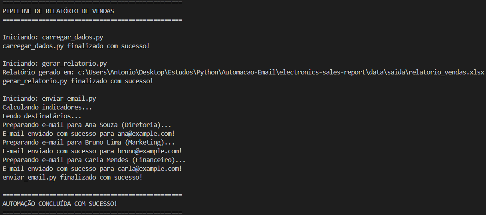
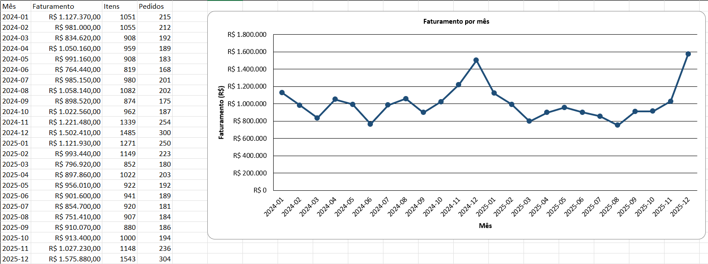
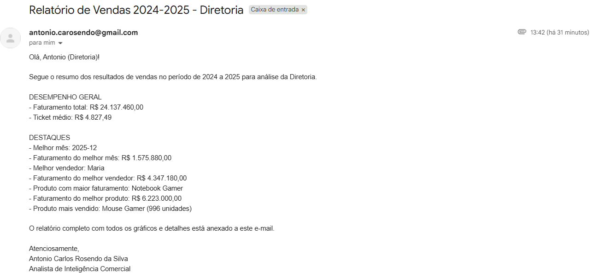

# Electronics Sales Report (Pipeline de Relatório de Vendas)

Este projeto é um pipeline completo de dados desenvolvido em Python. Ele automatiza o fluxo de ponta a ponta: desde a geração de dados fictícios de vendas de eletrônicos, passando pelo armazenamento em banco de dados, cálculo de indicadores de negócios, até a criação de um relatório formatado em Excel e o envio segmentado por e-mail para diferentes setores da empresa (Diretoria, Marketing e Financeiro).

## Tecnologias Utilizadas

*   **Python 3**
*   **Pandas:** Manipulação e análise dos dados.
*   **SQLite3:** Banco de dados relacional leve (nativo do Python).
*   **OpenPyXL:** Criação e formatação de planilhas e gráficos no Excel.
*   **smtplib / email.message:** Envio automatizado de e-mails via protocolo SMTP.
*   **python-dotenv:** Gerenciamento de variáveis de ambiente de forma segura.

## 📁 Estrutura do Projeto

```text
electronics-sales-report/
├── data/
│   ├── entrada/
│   │   ├── destinatarios.xlsx   #Planilha com Nome, Email e Setor
│   │   └── vendas.csv           #Base de dados fictícia gerada
│   ├── saida/
│   │   └── relatorio_vendas.xlsx #Relatório final gerado pelo script
│   └── vendas.db                #Banco de dados SQLite
├── images/                      #Prints para documentação
├── src/
│   ├── carregar_dados.py        #Carrega o CSV para o SQLite
│   ├── corpos_email.py          #Textos dinâmicos para cada setor
│   ├── enviar_email.py          #Orquestra o envio via SMTP
│   ├── formatacao.py            #Regras de formatação (ex: Moeda)
│   ├── gerar_dados.py           #Cria a base de dados fictícia
│   ├── gerar_relatorio.py       #Monta o arquivo Excel com gráficos
│   ├── indicadores.py           #Consultas SQL para as métricas
│   └── main.py                  #Arquivo principal que roda o pipeline
├── .env.example                 #Exemplo de configuração de ambiente
├── .gitignore                   #Arquivos ignorados pelo Git
└── requirements.txt             #Dependências do projeto
```

## ⚙️ Como Configurar e Executar

1. **Clone o repositório:**
   ```bash
   git clone https://github.com/antoniorosendo/electronics-sales-report.git
   cd electronics-sales-report
   ```

2. **Crie e ative um ambiente virtual:**
   ```bash
   python -m venv venv
   #No Windows:
   venv\Scripts\activate
   #No Linux/Mac:
   source venv/bin/activate
   ```

3. **Instale as dependências:**
   ```bash
   pip install -r requirements.txt
   ```

4. **Configure as Variáveis de Ambiente:**
   Renomeie o arquivo `.env.example` para `.env` e preencha com suas credenciais do Gmail (lembre-se de usar uma "Senha de Aplicativo" se tiver verificação em duas etapas):
   ```env
   GMAIL_USER=seu.email@gmail.com
   GMAIL_APP_PASSWORD=sua_senha_de_app
   ```

5. **Execute o Pipeline:**
   Basta rodar o arquivo principal para que todo o fluxo aconteça automaticamente:
   ```bash
   python src/main.py
   ```

## 📊 Resultados e Funcionalidades

O pipeline executa as etapas de forma sequencial, garantindo a integridade dos dados. Veja abaixo o terminal durante a execução:



### 📈 Relatório Excel Automático
O script SQL calcula métricas como Faturamento Total, Ticket Médio e Melhores Produtos. O OpenPyXL pega esses dados e monta uma planilha com abas separadas e gráficos formatados.



### ✉️ E-mails Segmentados
O sistema lê a base de destinatários e formata o corpo do e-mail de acordo com a área da pessoa (Diretoria recebe um resumo executivo, Marketing foca em produtos e Financeiro em faturamento por categoria).

*(Adicione aqui um print da sua caixa de entrada mostrando o e-mail recebido com o anexo)*
